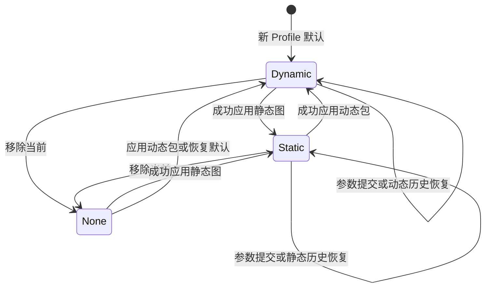

# Kinich 复杂动态壁纸 Specification

**文档标识：** KINICH-WALLPAPER-SPEC  
**规格版本：** 1.0.8  
**日期：** 2026-10-18，Asia/Shanghai  
**项目：** `dsh-kinich-theme`  
**代码基线：** Kinich 1.8.1  
**基线提交：** `3e7bb88f946c0f33ea3fffeb70cee96e49968a5a`  
**目标：** 本机 DSH Desktop 0.2.0 系列  
**本文职责：** 定义需求、视觉、交互、数据、兼容性与验收规格；实现状态和逐项验收结果由开发记录维护。

## 0. 如何使用本规格

### 2026-10-18 主题互斥补充（覆盖此前允许同时开启的表述）

**THEME-EXCLUSIVE-01**：Kinich 与 Xiao 可同时安装，但同一 Profile 内最多开启一个完整主题。两边必须有独立于动态壁纸开关的主题总开关；关闭总开关卸载视觉层并释放品牌插槽，保留全部壁纸、历史、参数和动效偏好。仅关闭动态壁纸不等于关闭 Kinich 主题。

**THEME-EXCLUSIVE-02**：开启某主题必须先成功保存另一主题关闭；另一主题关闭失败则中止。两者均关闭时恢复原生界面，不自动开启任一主题。旧配置冲突默认保留 Kinich；之后明确关闭到开启的主题优先。客户端不得同时展示两套，宿主通过公开设置接口持久化修复；不能宣称跨命名空间写入是原子事务。

**THEME-EXCLUSIVE-03**：互斥不能删除任何素材或历史，不能通过删减既有动效达成。配套改动需与 Xiao 1.3.0 一并交付；当前 Kinich 源码基线 2.0.2 的本地测试包不可冒充 npm 已发布同版本，正式交付须另取新版本。旧 Kinich 没有总开关时，Xiao 必须阻止混开并要求升级或市场停用旧包。细则与证据见 Xiao 的 `docs/UPGRADE_1.3.0_SPECIFICATION.md` 及本轮开发记录。

本文是后续升级开发、代码审查和 Desktop 验收的统一依据。开发者必须按条款编号追踪实现和验收证据，不能仅凭“看起来差不多”“构建通过”或某个演示页面运行正常宣布完成。

本文区分三种信息：

- **U：用户确认的约束。** 见第 1 节，改变这些约束必须取得用户明确确认。
- **R：参考站实测或公开实现中的设计事实。** 见第 3–5 节及参考审计记录。它们固定到本次观察，不自动跟随网站未来改版。
- **S：本规格确定的产品与工程规则。** 包括中等值的数值定义、壁纸播放流程、输入隔离、历史格式和验收方法。这些是为实现已确认需求而制定的设计决定，不声称用户曾逐项口述，也不声称是参考站原有行为。

“必须”表示验收条件；“应”表示默认工程做法，改变时须记录理由并证明同等结果；“可”表示不影响完成判定的实现自由。不得把“必须”降级成“尽量”。

1.0.2 按用户后续指示取消了多尺寸专项验收、操作路径/焦点/输入类交互专项验收、性能记录、长时间运行测试和回归验证门槛；产品功能、交互设计、数据正确性、参考模板视觉、导入导出及版本规则本身仍是规格要求。交互专项取消覆盖 hover/快速逆转/E=0 浏览/宿主输入审批菜单/浏览退出路径（AC-06、AC-13、AC-20、AC-32–AC-34）；静态模板视觉内容验收仍保留。取消验收不等于相关功能已通过或可宣称已验证。

本规格本身不授权公开发布。用户已明确授权将开发候选直接替换其 DSH Desktop 中已有插件并用于本机验收；该授权不包含 npm/GitHub 发布。当前安装器文件的产品版本实测为 `0.2.0-rc.2`；该结果只证明本地安装器版本，不等同于已核对正在运行的 Desktop 版本。若记录宿主版本，仍须以实际运行版本为准。

## 1. 用户已确认的需求

| 编号 | 已确认内容 | 必须保持的含义 |
| --- | --- | --- |
| U-01 | 欢迎页、会话中、空闲时和整个内容窗口都有壁纸 | 不局限于欢迎页，不覆盖原生标题栏和窗口边框 |
| U-02 | 不随 Session 状态变化 | 发送、运行、等待、完成、错误不得改变新壁纸的颜色、场景或节奏 |
| U-03 | 选择参考 04，严格模仿 Camille Mormal 网站的所有设计 | 覆盖首页、总览、详情、页脚、About、加载和各类过渡；不能仅用一张全屏图替代 |
| U-04 | 节奏、幅度、数量、可见度从完全没有到夸张显示，默认中等启用 | 四项独立可调，零值必须真实生效 |
| U-05 | 节奏零值 | 停止随时间运动，保留当前画面 |
| U-06 | 幅度、数量、可见度零值 | 分别取消对应变化、附加元素、壁纸显示；不删除已保存配置 |
| U-07 | 素材授权调查不列为该壁纸工作的前置事项 | 实际采用内容在 Third Party 记录；最后一行必须为“如有侵权，联系删除” |
| U-08 | 不考虑暂停情况 | 不新增失焦、最小化、遮挡等专门暂停策略或专项验收矩阵 |
| U-09 | 继续保留减少动态效果覆盖 | 无障碍覆盖有效，原有动画实现及用户参数保留 |
| U-10 | 支持本机最新的 0.2.0 Desktop | 不增加 Web 端交付或验收范围 |
| U-11 | 动态与静态背景只能存在其一 | 任一时刻最多一个活动背景模式；历史可同时保存两种素材 |
| U-12 | 强调色保持自动采集，一次采集结果 | 不逐帧、逐场景或随 Session 重采色 |
| U-13 | 按 Profile 独立 | 当前设置、素材和历史在 Profile 间隔离 |
| U-14 | 历史保存可恢复素材及当时参数 | 不能只保存路径、URL、缩略图或事件名称 |
| U-15 | 清除历史保留当前壁纸 | 当前素材、参数和恢复能力不受历史清除影响 |
| U-16 | 更换、清除、导入导出、升级、回滚、卸载后保留历史 | 软件更新和插件卸载不得顺带删除历史素材 |
| U-17 | 删除整个 Profile 或 DSH 数据目录属于例外 | 不承诺在这些数据目录被用户整体删除后恢复历史 |
| U-18 | 形成十分详细的 specification，后续严格依此开发验收 | 本文必须包含可执行规则和完成标准 |
| U-19 | 最终确认的复杂动态壁纸版本为 v2.0，此前版本不得超过 2.0 | 插件最终正式版本为 2.0.0；此前候选版本必须低于它，不得先发布 2.0.1、2.1 或 3.x |

用户没有给出 CPU/GPU 占用百分比、耗电、温度或低配电脑型号的硬性上限。本文的性能条款属于 S 类工程验收规则，不得写成已经取得的设备实测结果。

## 2. 范围与宿主边界

### 2.1 交付范围

**SCOPE-01**：交付一个原生 Kinich 壁纸功能，使用 DSH 声明的插件接口在 Desktop 内容区域工作，设置入口保持 **Settings → Kinich**。

**SCOPE-02**：背景必须连续铺到欢迎页、会话、侧栏、设置页和面板背后。页面转换只改变宿主内容的覆盖关系，不重建壁纸播放状态，不启动另一套壁纸时钟。

**SCOPE-03**：严格模仿的是参考站的视觉设计与交互模板。网站中的作者身份、职业经历、获奖经历和商业项目说明不成为 Kinich 作者的个人履历；壁纸包用自身真实素材说明填充同样的排版结构。参考图像可作为默认参考素材包的内容，实际嵌入范围必须有来源清单。

**SCOPE-04**：保留 Kinich 已有环境动画、点击反馈、阿乔反应、会话状态、余额和沉浸视差的实现、设置及可用性。不能通过删除或永久关闭旧效果获得新功能的性能指标。旧效果仍可遵循其既有页面规则；新壁纸不继承“会话中暂停环境循环”的旧规则。

**SCOPE-05**：新壁纸参数只作用于新壁纸。旧 `visualIntensity`、`animateAjaw`、角色、纹理、位置等设置不被偷偷改写。现有 `ambientMotion=false` 作为用户关闭动态环境的总覆盖，冻结新壁纸装饰运动，但不删除其参数；阿乔仍由自己的设置控制。

### 2.2 宿主行为

**HOST-01**：DSH 保有自己的导航、Session、消息、审批、输入框、设置壳、菜单和快捷键。

**HOST-02**：常规使用中，壁纸层不截获鼠标、滚轮、文本选择、拖放、Tab、方向键、空格、Enter、Escape、发送快捷键或 IME 输入。参考站的全局输入拦截不得原样移植到 DSH。

**HOST-03**：新功能不得修改 DSH 自带组件、替换其路由、劫持浏览器 history、给宿主文件打补丁，或写入宿主私有全局状态。

**HOST-04**：旧插件清单中的 Client `platform: web` 是现有 DSH WebView 客户端的实现声明；本文没有据此增加 Web 平台产品范围。不得未经验证将清单值换成猜测的 Desktop 枚举。

### 2.3 第一版载体

**MEDIA-01**：动态壁纸是可保存的图像场景包及本地交互渲染，不是对参考网站的在线 iframe 包装。

**MEDIA-02**：第一版支持现有静态 PNG/JPEG/WebP，以及由这些图像、文字说明和场景参数组成的动态场景包。ZIP 导入导出是数据容器，不能包含可执行脚本、HTML 页面或远程加载入口。

**MEDIA-03**：第一版不以 GIF、MP4、直播网页、Wallpaper Engine 桥接或额外常驻进程作为必需依赖。以后加入其它载体需要单独扩展规格、历史格式和验收。

## 3. 参考基准、证据与完整性

### 3.1 固定参考

参考网站：[Camille Mormal](https://camillemormal.com/)。本次查看首页、首页总览、[Gucci 详情模板](https://camillemormal.com/gucci)及 [About 模板](https://camillemormal.com/about)，并读取页面公开样式和公开渲染脚本中的布局、缓动与模板定义。

本次公开脚本 UTF-8 内容的 SHA-256：

`a8c103d4e6f3f57534e8208b05fae57aa48a7b58c7b552723609639cc8f40dfe`

**REF-01**：以上日期、页面和内容哈希共同确定版本基准。网站将来改版，不自动改变本规格。

**REF-02**：参考审计见 [REFERENCE_AUDIT.md](wallpaper-reference/2026-10-08/REFERENCE_AUDIT.md)。截图是参考站观察证据，不是 Kinich 原型或 Desktop 验收结果。

**REF-03**：当前完成的是公共模板观察与源参数核对，未逐张核验全部项目的最终图片。开发阶段必须补全所有项目的素材顺序、纵横比、留白序列、页脚指向和视觉截图。不得把首页标题旁的图片数量直接当成已经下载成功的素材数量。

### 3.2 参考项目目录

| 顺序 | 参考详情页 | 首页显示的数量 | 要求 |
| --- | --- | --- | --- |
| 1 | [/gucci](https://camillemormal.com/gucci) | 12 | 首屏、画廊、缩略导航、下一项目完整核对 |
| 2 | [/samsung](https://camillemormal.com/samsung) | 19 | 同上，不能用项目 1 的素材排列代替 |
| 3 | [/rituals](https://camillemormal.com/rituals) | 16 | 同上 |
| 4 | [/moco](https://camillemormal.com/moco) | 15 | 同上 |
| 5 | [/sennheiser](https://camillemormal.com/sennheiser) | 16 | 同上 |
| 6 | [/swarovski](https://camillemormal.com/swarovski) | 15 | 同上 |
| 7 | [/activia](https://camillemormal.com/activia) | 11 | 同上 |
| 8 | [/saeco](https://camillemormal.com/saeco) | 14 | 同上，最后一项的实际页脚目标须另核 |

首页标注合计为 118。数量是参考目录信息，不是用户素材包的强制数量，也不是本轮已保存 118 张图片的声明。

**REF-04**：默认参考包必须保留八项目的顺序和全部设计模板。删掉详情、About、页脚或加载模板属于范围缺失。

**REF-05**：遇到参考原图失效、字体不能取得或网络阻断，须记录具体资源及受影响的条款。占位色块、系统默认字体和普通淡入不能被记为严格还原已通过。

### 3.3 模板覆盖清单

| 模板/行为 | 必须覆盖的元素 | 对应条款 |
| --- | --- | --- |
| 初次加载 | 深灰底、小型居中百分比、图像网格入场、分阶段文字揭示 | V-01、M-01 |
| Work 全屏 | cover 图、中心标题、两侧十字、顶部导航、右下横向缩略图带、页码 | V-02、M-02 |
| Work 总览 | 深灰底、居中竖向图像卡片、横向队列、中央十字、裁切视差 | V-03、M-03 |
| 标题悬停 | 数量标记揭示、掩膜文字进出 | V-04、M-04 |
| 详情首屏 | 全屏图、右侧说明、左上 Back、右上编号、下移入口与细线图标 | V-05、M-05 |
| 详情画廊 | 保持图像比例、两级留白、右侧纵向缩略导航及视口框、左侧进度线 | V-06、M-06 |
| 下一项目 | 竖向预览图扩大为全屏、进度数字、中心文字、上下交接 | V-07、M-07 |
| About | 左侧微缩全文与视口框、右侧大字、六段结构、滚动逐行揭示、署名链接 | V-08、M-08 |
| 全局反馈 | 导航激活/悬停透明度、链接反馈、返回、快速逆转、窗口尺寸重算 | V-09、M-09 |

## 4. 严格视觉规格

### 4.1 坐标与缩放

所有值使用 CSS px，以 **壁纸自身内容区域**的宽 W、高 H 为计算基础，不能读取整个物理显示器尺寸代替。常规背景用 DSH 内部完整内容区域；浏览/校准视图用其实际绘制区域。

公开实现中的图像设计基准和 CSS 字体基准不同，必须分别计算：

```text
若 W/H > 16/9：图像缩放 q = H/1000，文字缩放 t = H/1080
否则：         图像缩放 q = W/1600，文字缩放 t = W/1920
```

**V-00**：不得把 q、t 合并为一个比例。固定 16 px 导航、固定 22 px 十字和固定 40 px 边距也不得一概乘上缩放系数。

多尺寸与多显示器的 Desktop 专项校准已由用户取消，不要求运行或提交多尺寸证据。上述 CSS 布局公式仍是实现规则；取消专项测试不得表述为多尺寸支持已通过验证。系统缩放改变 device pixel ratio，不改变上述 CSS 布局公式。

### 4.2 公共设计

**V-01**：基础底色 `#141414`，前景白色 `#FFFFFF`；过渡遮幕使用参考实现的近黑色 `#0E0E0E`。默认参考图保留原色，不叠加 Kinich 绿色滤镜。图片外的空白空间使用基础底色。

参考站署名识别字体为 **Söhne Buch**，页面字体资源为 `/static/font/s.woff2`，常规字重 400。壁纸专属文字使用对应字体；字体规则仅限壁纸子树。中文素材说明使用本机中文回退字体，不能使 DSH 全局字体发生变化。参考包严格校准不得在字体未加载时进行。

顶部导航 top=37 px，字号 16 px、行高 20 px，整体居中，各项左右 margin=22 px。激活与悬停 opacity=1，未激活 opacity=0.3。边距及字号为固定 CSS px。

加载百分比字号 `18t`、行高 `22.5t`、letter-spacing=0.05em；必须反映真实的必需资源准备进度。缓存齐备时允许立即显示 100%，不能制造假进度或永久等待失败资源。

### 4.3 Work 全屏与总览

**V-02**：全屏图片使用等比例 cover 裁切，默认中心对齐；须保持参考包内对应的主体位置。图片绘制区域允许扩出四边 1 px，避免变换时露缝，不允许非等比拉伸。

中心标题字号 `60t`、行高 `82t`、letter-spacing=-0.015em；标题容器从 `H/2-40t` 开始，水平方向居中。只呈现当前项目标题，其它标题留在各自掩膜外，不形成重叠多行文字。

两侧十字尺寸 22×22 px，top=`H/2-11`；左十字盒的 left=`16.1979% W`，右十字盒的 right 同值。总览改为中心十字，left=`W/2-11`。十字线厚约 1.5 px，不能用粗大按钮替代。

默认缩略图带：单图宽 `round(76q)`，高 `round(9×宽/16)`，间距 `round(5q)`；整个图带右、下边距各 40 px。默认八个项目缩略图按参考顺序排列。当前项与展开主图之间保持参考的变形交接，而不是重复显示两个独立的大主图。

首页页码在底部居中，bottom=36 px、字号 16 px、行高 20 px；参考规则在 W≤999 px 隐藏此页码，功能仍可从浏览工具条和设置页访问。

**V-03**：总览卡片宽 `round(350q)`，高 `round(500q)`，间距 `round(30q)`；中心卡片中心对齐视口。卡片图片保持 cover 裁切，纹理放大基准为 1.25。各项目沿横向队列排列，允许左右视口裁切；不变成纵向网页卡片列表。

全屏到总览的中间态必须包含从主图收缩、其它图像错列进入、缩略图退出及标题退出到稳定水平队列的过程。不能只改变最终宽高并淡入。

**V-04**：标题旁数量标记小于主标题、沿上侧定位，并从独立掩膜揭示。它仅是素材数量或对应信息，不是 Session 编号、模型用量或未读消息数。

### 4.4 详情与页脚

**V-05**：详情首屏高度 H，背景 cover；左上 Back 的 left=40 px、top=37 px。右上编号 right=39 px、top=37 px，字号 16 px、行高 20 px。

右侧文字块 left=`65.625% W`；主标题字号 `60t`、行高 `64t`、letter-spacing=-0.02em。角色/说明块宽 `21.875% W`、上限 420 px、字号 16 px、行高 21 px；次级说明白色 alpha=0.5。说明与贡献者区域分组，不挤成一个段落。

下移文字 bottom=37 px；图标 right=39 px、bottom=39 px，边界尺寸 47×55 px、细线白色 alpha=0.5。H≤620 px 按参考规则隐藏贡献者块；必要的信息仍在 About/素材信息中可读。

**V-06**：详情画廊图像保持原比例，中心排列：W>1700 px 时宽 900 px；否则宽 `52.9412% W`。整段前后 margin=`20.8333% W`；图间短间隔 40 px、长间隔 320 px。每个项目必须保存真实的长/短间隔序列，不能统一化。

右侧纵向缩略图列表和细线视口框必须存在，主画廊、微缩列表和框的滚动进度同步；图片旁标记与框不成为背景粒子。参考在 1440×900 下此列表宽约 60 px，框宽约 74 px；这些是本次样本测量，其他尺寸以参考模板规则重算。

左侧细进度线反映详情的有效滚动范围。进度=0 对应首屏，进度=1 对应可进入下一项目的末端；不得用加载进度代替浏览进度。

**V-07**：下一项目预览的初始图框为 `350q×500q`，中心对齐，纹理 scale=1.25；随末端展开进度扩大为视口 W×H，纹理 scale 同步归为 1。中心标题、短说明、扩展数字及进度线按各自掩膜进出。上下项目切换必须有纵向图像交接。

### 4.5 About 与内容填充

**V-08**：保留左侧微缩全文、右侧大文字、六段结构和视口框的设计，顺序为：简介、经历/变化记录、成果/特征、素材/关联项、联系/项目入口、Credits。Kinich 内容必须使用实际主题说明、版本记录、素材和项目链接填充，不能宣称原作者经历属于插件作者。

右主栏 left=`50% W-64px`、width=`50.1042% W`；正文字号 `2.8125vw`、行高 `3.6458vw`、letter-spacing=-0.02em。第一段 padding-top=`17.7083vw`，后续段 `14.5833vw`；页面底部留白 `17.7083vw`。

次级正文字号 `2.2917vw`、行高 `2.7604vw`；小字 `1.25vw/1.6667vw`，颜色 `#666667`。需要保持组内大、中、小字级差。

左微缩栏 left=`40px+3.2813vw`、width=`9.6354vw`，基础字号 `0.5409vw/0.7011vw`，起始 padding-top=`15.3446vw`。视口框 left=40 px、width=15vw、height=19.2308vh、边框约 1.34 px、白色 alpha=0.2。

主文滚动、左侧全文位移和视口框位移用同一个归一化进度同步；点击/拖动微缩区域可定位主文，范围限于壁纸浏览区域。

**V-09**：壁纸专属导航、链接、Back 和图标保留参考的轻量透明度反馈。常规背景里的同款文字仅为视觉元素；只有明确进入壁纸浏览视图后才具有壁纸交互，不覆盖宿主控件。

## 5. 动效契约

### 5.1 参考时序

以下是公开实现中可核对的基准值。以节奏=50、幅度=50、非减少动态效果、参考校准状态为前提；四项调节的映射见第 7 节。

| 编号 | 动效 | 基准时序与要求 |
| --- | --- | --- |
| M-01 | 首次入场 | 图像网格重排/放大；标题起始约 3200 ms，侧十字约 3500 ms，页码与导航约 3800 ms；不是单纯图片透明度渐变 |
| M-02 | 标题/导航/页码揭示 | 基准 1500 ms，向下隐藏位置通过掩膜归位；主页标题偏移基准 140%，普通文字 110% |
| M-03 | 全屏/总览几何收敛 | 参考阻尼系数 0.083，并按帧间时间归一；图像队列有 40 ms 级联差，收回缩略图有约 240 ms 延迟 |
| M-04 | 标题数量悬停 | 显示 1200 ms，退出 300 ms；独立的 112% 掩膜位移 |
| M-05 | 主图进入详情 | 图像约 1290 ms，贝塞尔 `(0.64,0,0.12,1)`；详情文字延后约 800 ms，Back 延后约 1100 ms；标题逐行差约 70 ms |
| M-06 | 详情滚动 | 首屏纹理垂直裁切偏移从 0 到 -0.3；画廊图片与右侧导航连贯，不使用每轮滚动重新启动的 CSS 动画 |
| M-07 | 下一项目交接 | 图片约 1290 ms；旧图上移、新图从下方进入；页脚文字退出约 600 ms，子项差约 20/26 ms |
| M-08 | About 揭示 | 逐行 1500 ms，行间约 100 ms；左侧分区有 50 ms 级联、80 px 起始位移，最终 alpha 约 0.85 |
| M-09 | 十字与局部反馈 | 十字显现 1200 ms、隐藏 250 ms；换图侧十字按方向旋转 90°；导航透明度 300 ms |

参考缓动采用与公开实现对应的曲线：o6=`(0.19,1,0.22,1)`，o2=`(0.25,0.46,0.45,0.94)`，i3=`(0.55,0.055,0.675,0.19)`；局部缩放、显隐及位移须匹配相应曲线，不得统一替换为浏览器默认 ease。

**M-10**：总览纹理裁切偏移基准为 ±0.25；它随卡片相对横向滚动位置变化。本轮未发现流体扭曲、噪声粒子或多色霓虹着色的参考依据，这些不属于“严格模仿”的默认效果。

**M-11**：参考渲染主要是图像矩形几何、裁切缩放和纹理坐标偏移；不能把暂时斜向错列的中间态当成稳定的 3D 隧道设计。

### 5.2 中断与运动一致性

**M-12**：快速 A→B→A 从当前可见几何继续，取消旧目标的过期回调；不得先跳回起点或在结尾显示错误项目文字。

**M-13**：运动使用单调时钟和真实帧间隔。60 Hz、120 Hz、144 Hz 下同一动作的墙钟时长相同，不因帧数不同而加速。

**M-14**：resize 保留当前项目和归一化阶段，重新计算 W/H 与裁切。窗口拉伸期间不重复播放首次加载。

**M-15**：关闭主题、替换壁纸、切换 Profile、卸载挂载实例时，释放本实例的回调、监听器、动画及 GPU 对象；数据保留规则另见第 11–14 节。生命周期清理不等同于删除动画实现。

**M-16**：不新增窗口失焦、遮挡或最小化的产品暂停控制。运行平台自然节流/挂起不由插件保证；恢复帧将大时间间隔限为不超过 50 ms 的运动积分，避免瞬时跨越大量场景，不补播所有遗漏帧。

## 6. 常规背景与壁纸浏览视图

### 6.1 常规背景

**BG-01**：新动态场景始终位于 DSH 内容之后；所有壁纸节点常规状态 `pointer-events:none`，装饰内容从辅助技术树隐藏。宿主真实内容仍在正常 DOM 和焦点顺序中。

**BG-02**：同一 Profile、同一个 DSH 内容窗口只有一份活动壁纸播放实例。欢迎页进入会话或在设置页之间转换，不重置 sceneIndex、播放阶段或一次采色结果。

**BG-03**：新壁纸不读取 Session 状态作为动画输入。原阿乔与会话反馈可继续读取；两者状态必须分开，不能因共用 overlay 属性而误触发壁纸动效。

**BG-04**：常规背景保持 Work 模板的视觉循环；详情与 About 的完整交互可在浏览视图访问。它们不是会话消息/审批触发的背景状态。

### 6.2 默认自动播放（S 类 Desktop 适配）

参考站的手动交互事实不自动证明其有无人操作轮播。为了让默认启用的壁纸持续有动态，本规格定义以下 **Kinich 自动播放**，它使用参考已有几何路径，不增加另一种视觉风格：

```text
当前项目全屏稳定展示 12 秒
→ 展开为 Work 总览
→ 队列移动到下一项目
→ 恢复该项目全屏
→ 再稳定展示 12 秒
```

**PLAY-01**：12 秒是节奏=50 的稳定停留时间；过渡结束后才开始下一段停留。总览切换用参考阻尼收敛，必须进入稳定终态后再执行下一步。

**PLAY-02**：八项目按原顺序前进；末项通过已有队列运动回到首项，不能瞬移露出空白。单项目自定义包只做同一图的全屏/总览往返，不复制虚假的不同项目。

**PLAY-03**：自动播放不自动进入 About，不滚动详情长文，不更改壁纸的素材包、参数或强调色，不生成历史记录。

**PLAY-04**：加载准备、主题卸载和用户明确的零值/关闭动态环境/减少动态效果具有自己的状态；这些条件不按“窗口暂停策略”处理。

### 6.3 浏览与校准

**EXP-01**：Settings → Kinich 提供“浏览壁纸”和“参考校准”入口。浏览为插件自有视图，可访问全部模板；不会导航离开当前 DSH Session，也不会提交或取消消息。

**EXP-02**：浏览视图的退出按钮始终可见，位于插件自有工具条而不改动参考模板内部设计；Escape 只在该视图拥有焦点时退出并将焦点返回入口。不能注册常规界面全局 Escape 抢占器。

**EXP-03**：参考的滚轮、左右切换、标题点击、缩略图、Back、下一项目、Work/About、微缩导航只在浏览区域消费。DOM 不存在可见菜单时也不能阻断整个 DSH 输入。

**EXP-04**：进入浏览视图使用当前素材包与参数，但浏览动作不自动提交新的当前壁纸。提供“应用当前场景”明确动作；退出未应用的浏览返回先前活动配置，不写入历史。

**EXP-05**：浏览默认为手动交互；工具条可演示自动播放。浏览手动模式属于明确的交互模式，不根据窗口焦点进行暂停。

**EXP-06**：校准视图临时使用节奏=50、幅度=50、参考默认数量、可见度=100；完全展示参考模板，便于像素/时序比对。不得将这些临时值写回当前壁纸或历史。关闭校准恢复先前值。

**EXP-07**：正在申请审批、输入问题或有宿主模态层时，宿主模态层优先；壁纸不能遮挡其内容或夺取焦点。壁纸浏览不模拟 DSH 的模态关闭语义。

## 7. 四项控制的数值定义

### 7.1 公共约束

**CTL-01**：四项持久参数为整数 0–100，步长 1，默认均为 **50**。0 标注“无”，50 标注“中等”，100 标注“夸张”；另显示当前数值。没有正数以外的秘密最低动效。

**CTL-02**：正常变化必须单调：增大节奏不能降低速度，增大幅度不能降低相应偏移，增大数量不能减少可显示附加图像，增大可见度不能使壁纸更隐蔽。

**CTL-03**：滑条拖动即时预览；一次完成手势或键盘连续调节作为一次提交。写入失败回退已提交值并显示失败，不能把 UI 中的预览冒充已保存值。

通用倍率：

```text
g(p) = p/50                         当 0 ≤ p ≤ 50
g(p) = 1 + 2×(p-50)/50              当 50 < p ≤ 100
```

| p | 0 | 1 | 25 | 50 | 75 | 100 |
| --- | --- | --- | --- | --- | --- | --- |
| g(p) | 0 | 0.02 | 0.5 | 1 | 2 | 3 |

### 7.2 节奏 R

**CTL-R1**：速度倍率 s=`g(R)`；R>0 时所有壁纸时间型时长和时序延迟除以 s。默认参考速度为 1 倍，100 为 3 倍；稳定停留 `12000/s` ms。

**CTL-R2**：时间归一阻尼定义为 `a=1-(1-0.083)^(dt/(1000/60)×s)`，据此向目标插值。不能为高刷新率重复套用未归一的 0.083。

**CTL-R3**：R=0 立即冻结当前可见壁纸画面，停止自动推进、持续缩放、旋转、裁切变化、级联和装饰过渡。不得将其替换为静态模式，历史中的模式仍为 dynamic。

**CTL-R4**：冻结时仍可操作设置。用户明确切换场景/模板或应用另一张壁纸时，直接显示目标的稳定画面；不播放等待运动完成才能执行的动画。加载百分比可更新，不能因 R=0 永远停留在加载幕。

**CTL-R5**：冻结时修改幅度、数量或可见度可以产生一次确定性的静态重绘，但不能启动时间型动画。V=0 时可以省略光栅绘制，逻辑播放时钟仍遵循 R 与无障碍覆盖，不另增一套隐含的暂停规则。

### 7.3 幅度 A

**CTL-A1**：运动偏移、纹理裁切偏移、十字旋转角、过渡附加缩放、字行掩膜偏移使用 a=`g(A)`。

**CTL-A2**：A=50 对应参考基准：换图十字 90°、总览裁切 ±0.25、详情首屏裁切 -0.3、过渡附加缩放 0.15、常用行掩膜 110%。A=100 对应这些可调分量的 3 倍。图像 UV 必须有合法边界和足够 overscan，不允许采出黑缝。

**CTL-A3**：模板稳定几何、文字字号、导航位置、真实图片比例、命中框与数据内容不乘幅度倍率。大幅度改变过程，不把整个 DSH 放大或移走。

**CTL-A4**：A=0 时上述视觉变化完全取消；用户选择布局或项目时直接切到稳定终态。自动循环仍可按节奏换到下一张稳定图，但不残留缩放、位移、十字旋转或掩膜动画。

### 7.4 元素数量 E

**CTL-E1**：数量控制附加图像的显示密度，不改变素材包内容，也不删除项目。基础当前主图、退出按钮、键盘访问和必要说明不计为附加元素。

```text
N(0)=0
N(E)=ceil(8×E/50)                    当 1 ≤ E ≤ 50
N(E)=8+ceil(16×(E-50)/50)             当 50 < E ≤ 100
```

**CTL-E2**：默认附加数量上限 8，最大上限 24。默认参考包显示原八项封面缩略图；高于 8 时从同包真实详情图中按固定顺序补充缩略图/过渡图像，不生成另一类粒子或随机图形。数据不足时数量受可用独立图像数限制，设置页须说明。

**CTL-E3**：E=0 不显示缩略图带、画廊附加预览列及装饰图像队列；保留一张当前主图。浏览视图仍有工具条的前后项目/布局操作，不能因视觉附加元素为零而无法退出或选择素材。

**CTL-E4**：高密度仍保持原图像矩形语言、裁切和排列规则。附加图像不能覆盖宿主输入，不改变严格校准中默认八项的布局。

### 7.5 可见度 V

**CTL-V1**：壁纸自身图像与装饰 alpha=`V/100`。V=0 不显示图像、标题、十字、缩略图或新壁纸底幕；当前素材和参数保持保存。V=100 无额外淡化壁纸。

**CTL-V2**：有活动背景且 V>0 时，同时沿用 1.8.1 的语义表面 alpha 插值，令 v=`V/100`：`alpha=from+(to-from)×v`。不能靠额外黑/白染色层代替表面透明度控制。

| 表面 token | 浅色 from→to | 深色 from→to |
| --- | --- | --- |
| `--dsw-alias-bg-base` | 0.48→0.20 | 0.40→0.16 |
| `--dsw-alias-bg-layer-1` | 0.94→0.50 | 0.92→0.44 |
| `--dsw-alias-bg-layer-2` | 0.96→0.56 | 0.94→0.50 |
| `--dsw-alias-bg-layer-3` | 0.97→0.62 | 0.96→0.56 |
| `--dsw-alias-bg-overlay` | 0.98→0.68 | 0.97→0.62 |
| `--dsw-alias-bg-module-platform` | 0.95→0.56 | 0.93→0.50 |
| `--dsw-alias-bg-multi-select` | 0.94→0.52 | 0.92→0.46 |
| `--dsw-specific-sidebar-fill` | 0.88→0.45 | 0.85→0.40 |
| `--dsw-specific-bubble` | 0.96→0.60 | 0.94→0.54 |
| `--dsw-specific-bubble-highlight` | 0.94→0.56 | 0.92→0.50 |
| `--dsw-specific-menu` | 0.98→0.72 | 0.97→0.66 |
| `--dsw-specific-selector` | 0.96→0.60 | 0.94→0.54 |

**CTL-V3**：V=0 或模式 none 恢复正常无背景表面，而不是保留透明宿主后露出另一份旧静态图。自动强调色若已启用且有效，可保持；可见度不是强调色开关。

**CTL-V4**：V=50 时 layer-1 表面 alpha 为浅色 0.72、深色 0.68，壁纸自身 alpha=0.5。这是本规格的中等可见度；不是 1.8.1 原默认 75 的同义改名。

**CTL-V5**：可见度同时适用于静态和动态。切换模式时采用各自保存的参数快照，不用一种模式的临时值覆盖另一种历史参数。

## 8. 互斥、默认值与操作语义

活动模式严格为 `none | static | dynamic`，动态运动是否冻结另行计算。冻结动态、不可见动态均仍是 dynamic。



提交失败保留原节点。清除历史不触发任何模式转换；浏览/校准是临时视图，R=0、V=0、减少动态效果是显示覆盖，均不构成第四种背景模式。

| 操作 | 活动结果 | 历史结果 |
| --- | --- | --- |
| 新 Profile 首次使用 | 内置参考动态包，四项=50，自动强调色开启 | 初始活动快照建立，不虚构操作历史 |
| 旧 Profile 有静态图 | 保持旧静态图、旧可见度和旧强调色开关 | 首次迁移保存其可恢复快照 |
| 旧 Profile 无自定义图 | 初始化默认动态包，保留所有旧动效设置 | 迁移标记一次，不能每次重启新增 |
| 选择动态包 | dynamic；停止绘制静态图 | 保存被替换的活动快照 |
| 选择静态图 | static；不绘制动态场景 | 保存被替换的动态快照 |
| 移除当前壁纸 | none，恢复普通 Kinich 背景 | 当前壁纸进入可恢复历史 |
| 恢复默认壁纸 | 默认动态包和四项=50 | 保存原活动快照；不清空历史 |
| 参数重置 | 当前包不变，四项=50 | 保存重置前快照 |
| 清除历史 | 当前模式、包、参数、采色不变 | 移除全部非活动历史引用 |
| 恢复历史项 | 恢复该项模式、素材、参数、采色 | 保存恢复前的活动快照 |

**MODE-01**：“互斥”针对显示和播放，不是强行从磁盘删掉另一个模式的素材。缓存中可留有解码数据，不能有另一套隐藏但持续播放的动态壁纸实例。

**MODE-02**：动态解码/渲染失败，优先显示同一动态包的代表静帧，并标记“动态显示暂不可用”；不能自动切到另一个历史静态背景，伪装为动态与静态切换成功。

**MODE-03**：旧 `customBackgroundImage` 字段在动态活动时不能继续通过 CSS 背景绘制。旧兼容字段的保存与显示选择必须分离；静态恢复后才重新采用该静态内容。

**MODE-04**：默认启用不覆盖用户已经作出的背景、环境关闭或减少动态效果选择。迁移后明确清除成 none 的用户不在下次启动时被自动重置成默认 dynamic。

### 8.1 动态壁纸启用开关

**ENABLE-01**：设置 06 顶部提供明确的“启用动态壁纸”开关。持久字段 `dynamicWallpaperEnabled` 为布尔值，按当前 DSH Profile 的 Kinich 配置独立保存，默认 true；旧配置缺失该字段采用 true，不改写现有壁纸模式。保存使用宿主配置接口，不使用会话状态或浏览器全局 localStorage。保存中禁用重复操作；失败显示原有配置错误反馈，保持最后成功保存的状态。

**ENABLE-02**：false 且活动模式为 dynamic 时，不挂载动态壁纸图层和浏览输入表面，退出浏览/校准/自动演示，停止该壁纸帧调度，释放其 WebGL 纹理、程序、缓冲区、字体和监听器。宿主恢复普通无背景表面。当前模式仍为 dynamic，当前素材、固定代表图、项目、模板、保存的浏览位置、四项参数、采色结果及派生色保持不变；不调用移除壁纸、清历史或垃圾回收操作，不创建历史快照，不增加壁纸索引 revision。

**ENABLE-03**：重新开启采用当前选定快照的素材、参数及场景；常规背景仍按原有 Work 播放规则。重新建立渲染实例，不承诺恢复关闭前的瞬时动画进度，不补播关闭期间动画。关闭后重启仍保持关闭，开启后重启保持开启。素材管理、导入/导出、历史恢复和参数编辑在关闭时仍可用；浏览和参考校准入口禁用，不能绕过关闭开关。

**ENABLE-04**：开关与可见度独立。开关开启且 V=0 仍遵守 CTL-V1/CTL-R5 的不可见及逻辑时钟规则；开关关闭时不运行动态壁纸时钟，V 不被改为 0。再次开启仍采用保存的 V。R=0 与 ambientMotion=false 的冻结、减少动态效果覆盖和本开关分别处理；开关不修改它们。

**ENABLE-05**：仅影响 dynamic。活动模式 static 时，无论该开关 true/false，静态图及其可见度保持有效；模式 none 不因开启而自动恢复默认壁纸。关闭 dynamic 不自动显示另一份旧静态图。关闭期间导入并应用 static，正常显示 static；之后明确应用/恢复 dynamic，仍保持动态开关关闭，直到用户开启。恢复默认、清历史和恢复历史不重置该 Profile 开关。

**ENABLE-06**：自动强调色开关保持独立。关闭动态壁纸后，若当前动态快照的 autoPalette=true，继续使用其已保存强调色及浅/深派生色；autoPalette=false 使用 Kinich 预设色。关闭/开启、改可见度、切浅深模式不触发重采。未完成的一次采集在重新开启后按原有一次采集规则完成，不为开关额外生成采色快照。

**ENABLE-07**：该字段属于 Profile 的插件运行偏好，不属于素材/参数快照，因此壁纸包导入导出不携带或覆盖目的 Profile 的开关；历史恢复不覆盖它。升级保留原配置中保存的 false/true；删除整个 Profile/DSH 数据目录仍在历史保留承诺之外。开关不关闭旧环境动画、点击反馈、阿乔、角色或沉浸视差，不修改 SCOPE-04/05 的旧动效设置。

**AC-60**：代码验收覆盖开关关闭/开启/重新读取 Profile 配置，关闭后动态层与 RAF 清理、开启恢复参数/素材/已采色，static/none 与 V=0 的独立语义，配置拒绝时不假报保存成功、Profile 隔离及壁纸历史不变。按用户 2026-10-13 指示，本次无需 Computer Use；桌面显示由用户人工复核，不把源码/模拟检查称为真实桌面截图验收。

变更记录（2026-10-13）：1.0.2→1.0.3，新增 ENABLE-01–07 和 AC-60；保留前三项用户人工验收确认、既有动效和已取消验收项。稳定版宿主必须以本机内置应用版本及官方发行状态核实，PE ProductVersion 0.2.0.0 不可替代 `0.2.0-rc.2` 的真实版本。

## 9. 强调色与减少动态效果

### 9.1 一次采集

**COLOR-01**：每份素材快照有固定代表图 `representativeAssetId`；动态包默认为第一项目的全屏封面。代表图不随轮播、当前浏览页、场景滚动、曝光/可见度或 Session 改变。

**COLOR-02**：在成功导入/建立新包时，以代表图未经可见度淡化的图像像素调用现有 `extractDominantKinichAccent`。保留该算法的透明/近灰/极暗极亮像素过滤以及有限采样逻辑。

**COLOR-03**：保存代表图内容哈希、采样算法版本、原始采色结果和当前算法派生出的浅/深强调色。无有效色则采用 Kinich 对应预设色，不循环重试采样。

**COLOR-04**：恢复历史采用其保存的原始采色和算法版本；升级不自动对全部历史重采。若算法将来改变，需要显式、可追溯的迁移规则。

**COLOR-05**：浅/深主题切换仅选择现有派生色，不重新读取图片；自动配色关闭回到 Kinich 预设强调色，再开启读取已保存结果。

**COLOR-06**：只改强调色家族；成功、警告、错误等语义 token 保持现有含义。保留现有配对色对预设表面的对比检查；不得宣称该检查同时证明所有摄影背景上的宿主文本可读。

### 9.2 运动覆盖顺序

```text
关闭 Kinich → 壁纸挂载不存在，数据保留
模式 none → 新壁纸不存在
prefers-reduced-motion: reduce → 新壁纸稳定静帧，保留其参数
ambientMotion=false → 新壁纸稳定静帧，保留其参数
节奏=0 → 冻结当前画面
其余 → 按节奏、幅度、数量、可见度执行
```

**A11Y-01**：减少动态效果时取消装饰自动轮播、裁切视差、十字旋转、级联及大面积几何运动。明确用户选图/返回允许直接更新稳定状态，局部必要反馈不超过 80 ms。

**A11Y-02**：系统覆盖不改写四项数值、模式、素材或历史。覆盖撤销后使用原保存值重新进入可运行状态，不补播漏掉的循环。

**A11Y-03**：常规背景不添加重复可访问标题和重复屏幕阅读文本。浏览控件提供实际名称、当前项、键盘访问和清晰焦点，原网站取消 outline/屏蔽 Tab 的做法不能移植。

## 10. 设置页与反馈

**UI-01**：沿用 Settings → Kinich 独立分区，增加“壁纸”内容组：当前模式与预览、静态/动态选择、素材包管理、四项控制、自动强调色、浏览/校准、历史和数据操作。保持已有阿乔、角色、环境、余额等全部设置。

**UI-02**：当前卡片显示素材包名称、模式、代表图、已保存的四项数值及异常状态。冻结/不可见的动态不能被误标为 static 或未配置。

**UI-03**：选择静态/动态前可显示预览；成功应用只需用户的应用动作，不叠加无意义的确认。原模式在准备及保存过程中保持可用，失败时继续原配置。

**UI-04**：“移除当前”“恢复默认”“清除历史”分为三个动作，不能共用一个模糊的“清除”按钮。清除历史明确说明保留当前；用户完成该明确操作后不得额外自动清除当前数据。

**UI-05**：历史列表每项包含缩略图、模式、用户名称或自动名称、提交时间、参数摘要、恢复和单项删除入口。列表默认按提交时间倒序，每批 30 项，按需加载，不一次解码全部历史。

**UI-06**：系统时间存 UTC；用户界面按本机时区显示，本轮文档日期采用 Asia/Shanghai。历史 ID 和排序次序不能依赖用户可能回拨的墙钟时间。

**UI-07**：处理中显示实际阶段；保存失败、素材缺失、GPU 故障、版本不兼容及磁盘空间不足各有可辨别信息。加载错误不能遮住退出、背景清除、导出和已保存历史。

**UI-08**：“清除历史”对正在进行的导入、参数提交和恢复采用串行事务边界。不能先清空列表再由更早的异步回调把已清除历史重新写回来。

## 11. 数据模型与 Profile 隔离

### 11.1 基本结构

以下名称是自有协议语义，非已经存在的 DSH API 或字段声明：

```text
WallpaperStore
  schemaVersion: 1
  specVersion: "1.0.0"
  revision: 单调递增整数
  active: Snapshot | null
  history: Snapshot[]
  assets: 以 SHA-256 为键的素材索引
  migrations: 已完成迁移标记

Snapshot
  id, sequence, createdAtUtc, reason
  mode: none | static | dynamic
  bundleId, bundleVersion, bundleManifestHash
  projectId, templateId, normalizedViewPosition
  parameters: rhythm, amplitude, elementDensity, visibility
  autoPalette: boolean
  representativeAssetId
  sampledAccent, derivedPalette, paletteStyleId, paletteAlgorithmVersion
  assetIds[], fontAssetIds[]
  contentManifest: 项目、素材顺序、比例、间隔、文字与来源
  originVersion, snapshotHash

Asset
  sha256, mediaType, byteLength, width, height
  relativeBlobPath, normalizationVersion
  sourceAttribution, sourceUrl(可选)
```

**DATA-01**：`projectId/templateId/normalizedViewPosition` 表示用户明确应用时的稳定视图，不持久化每帧浮点值、进行中的动画对象或 Session ID。

**DATA-02**：快照不可变。新提交建立新快照，引用相同素材内容哈希进行去重。相同字节不因导入时间、文件名或历史次数再次存储。

**DATA-03**：恢复必须仅依赖包内/数据目录内的素材字节和参数，不能依赖原本本地文件、当前网页、字体 CDN、绝对路径或只存在于旧 npm 包中的资产。

**DATA-04**：素材可以是导入后经过归一化的最终字节；“可恢复”指恢复当时实际显示的壁纸，不承诺恢复上传前的原始高分辨率文件或 EXIF。归一化规则及版本记录在资产索引中。

**DATA-05**：不在 Profile 的配置 YAML/JSON 中塞入整个动态包和全部历史。设置中只保存小型活动引用、模式和参数；素材与快照使用 Host 管理的耐久数据存储。

### 11.2 Profile 归属

**PROFILE-01**：数据位置必须来自经验证的 DSH Profile 作用域。参考逻辑位置为 `<当前 Profile 的耐久数据目录>/kinich-wallpaper/`，实际根目录的官方获取方式见第 15 节能力核实。

**PROFILE-02**：客户端不向服务器传入可任意解析的 Profile 绝对路径。Host 根据当前已授权的 Profile/连接作用域解析根目录；同名素材、相同哈希不导致跨 Profile 共享。

**PROFILE-03**：禁止以当前工作目录、插件 `node_modules`、临时目录、浏览器 origin 的 localStorage/IndexedDB 或全局 `.dsh/kinich-wallpaper` 作为最终存储。

**PROFILE-04**：浏览器 Blob/Object URL、GPU 纹理和内存缓存只作为运行态。重新启动和插件重装后仍能从耐久文件重新创建。

**PROFILE-05**：复制 Profile 时若 DSH 的复制操作包含耐久数据，其壁纸跟随复制；若只复制配置且缺少素材，须显示素材缺失，不能从另一 Profile 隐式取文件。

### 11.3 文件完整性与事务

**TX-01**：提交次序为：验证输入→归一化→写临时素材→计算内容哈希→确保素材耐久→写新索引/快照→提交活动引用→通知 Client。活动切换不能先于素材的耐久成功。

**TX-02**：Host 数据 revision 为权威。过期 Client 提交须检测冲突并重新取得快照，不采用无条件“最后覆盖一切”。多个同 Profile 窗口都遵循同一数据事务规则。

**TX-03**：若配置引用与数据索引不能在同一宿主事务提交，必须有耐久提交记录/日志支持重启恢复；不能假定现有 `settings.mutate()` 同时替文件系统提供原子性。

**TX-04**：故障发生在任何一步，重启后只能出现旧完整状态或新完整状态，不能出现静态和动态同时活动、半张素材、丢失旧历史或错误的采色结果。

**TX-05**：临时文件和未提交素材可在恢复事务中回收，但只能清理自身目录内明确确认没有活动/历史/导出/迁移引用的对象。

## 12. 历史记录的完整语义

**HIST-01**：以下成功提交产生快照：更换素材/模式、参数的一次完整调节、自动强调色开关、明确应用浏览场景、移除当前、恢复默认、恢复历史、导入后的明确应用。

**HIST-02**：自动轮播、动画帧、窗口变化、切换 Session、浅深主题切换、打开预览、失败操作、重复相同值、不修改数据的导出不产生壁纸快照。导出操作可显示结果状态，但不虚构另一张壁纸。

**HIST-03**：历史中的所有参数、素材、文字布局数据、代表图及采色信息均为当时的快照。升级后的默认值变化不修改旧快照。

**HIST-04**：不设偷偷淘汰旧历史的数量上限，不按最近 N 张自动覆盖。空间不足时拒绝新提交并保留当前与历史；用户可明确清除。

**HIST-05**：清除历史保留活动快照和其全部可恢复资产，包括动态详情图、字体、代表图和参数。活动快照在独立“当前”区域显示，历史列表清空后数量为 0。

**HIST-06**：活动资产若同时被旧历史引用，清除历史只移除旧引用；物理回收依引用计数和事务版本进行。正常重启不能复活被清除的历史。

**HIST-07**：清除历史之后，用户下一次实际修改才产生新的历史；不能把此前被清除的整段列表重新导入当前记录。

**HIST-08**：单项删除只删除指定历史快照；当前项不通过历史删除入口删除。外部正在读取的导出任务取得一致性快照，清理不能使其导出半途缺文件。

**HIST-09**：某个历史资产损坏/缺失时保留该项元信息并标记不可恢复，恢复动作失败且当前壁纸不变；不能静默移除坏项或标记恢复成功。

## 13. 导入、导出与素材归一化

### 13.1 本地图像

**IO-01**：现有静态导入保持 PNG/JPEG/WebP、源文件≤15 MiB、≤40 百万像素，按比例缩放至最多 1920×1080，WebP data URL≤512 KiB；不保留原文件名/路径/EXIF。

**IO-02**：动态包图像同样验证真实类型、源文件≤15 MiB、≤40 百万像素；最终按比例最多 3840×2160，不放大小图，单素材归一化字节≤2 MiB。若通过质量/尺寸递减仍不能满足，整项导入明确失败。静态旧管线不因这项扩展被改变。

**IO-03**：默认参考素材的归一化不可造成明显文字图像模糊或裁切主体错误；压缩后的画质也属于严格视觉验收。不能仅因满足体积上限就记为合格。

**IO-04**：可在本地构建图像场景包：用户排列项目/图片、指定代表图和说明；缺少高级布局数据时按本规格模板生成确定性默认值。用户素材不足八项时不伪造八个商业项目。

### 13.2 可移植格式

**IO-05**：导出格式为版本化 `.kinich-wallpaper.zip`，包含 `manifest.json`、完整快照、`blobs/<sha256>.<受支持扩展名>`、必要字体及来源记录。只能用包内相对路径，不能依赖安装目录。

**IO-06**：提供“当前壁纸”“选定历史”“全部历史与当前”三种明确范围。当前壁纸导出包含其完整动态包而不只是当前场景封面。

**IO-07**：manifest 必须包含 formatVersion、schemaVersion、specVersion、导出范围、datasetId、素材哈希、快照哈希和记录数量。导出失败不得给出“完成”状态或把不完整文件当作有效包。

**IO-08**：采用流式/分批读写，不能把任意长度历史整体载入内存。单卷以 256 MiB 和 256 个独立图像资产为分卷边界；超出则生成带同一 datasetId 的分卷及总索引，不能截断历史。每个快照跨卷引用必须可由总索引解析。

**IO-09**：导入完整分卷时先核对总索引和所有必需资产，再提交。缺卷、哈希错、素材缺失、未知版本、路径穿越、重复冲突清单及非允许类型均失败，保持原状态。

**IO-10**：导入默认合并到当前 Profile 的可恢复记录，不覆盖当前壁纸；用户明确应用某项后才切换。不同 Profile 导出的资产在当前 Profile 重新建立独立存储，不能保留外部 Profile 路径。

**IO-11**：同一快照内容重复导入按快照哈希去重；同名不同内容各自保留。导出不删除本地历史，导入不能执行包里的 JS、HTML、命令、外部 URL 或宿主设置。

**IO-12**：必要字体仅接受具有真实 WOFF2 文件签名的 `.woff2`，且必须由内容清单明确引用并经过哈希验证。图像及字体分别按类型验证；外部 URL 仅为来源文字，不作为运行时加载地址。SVG 十字/图标由插件自身受控模板生成，不把导入包里的任意 SVG/HTML 变成可执行界面。

## 14. 升级、回滚与卸载

**MIG-01**：首次从 1.8.1 迁移，先备份该 Profile 的 Kinich 背景配置，确认旧 data URL 与采色有效，再建立 static 快照及内容哈希引用。旧动效设置原样保留。

**MIG-02**：迁移以耐久标记保证幂等：重启、安装重试、崩溃恢复不重复创建同一历史或丢弃首次快照。失败保留原静态背景并提供明确失败信息。

**MIG-03**：动态活动时可将旧静态绘制字段清空以防双层显示，但必须在新耐久快照已经成功后执行；旧静态可由新历史恢复，不能因清空兼容字段丢失素材。

**MIG-04**：插件升级前保留数据索引、旧 schema 标记及所有引用素材；新的内置参考素材不覆盖旧内置素材的历史版本。包自带资源升级前须确保活动/历史依赖的旧字节在耐久目录有副本。

**MIG-05**：新 schema 使用复制式迁移或可恢复的事务，旧版本数据不就地破坏。旧插件发现未来 schema 时不得将其视为垃圾重置。

**MIG-06**：回滚到不支持动态壁纸的 1.8.1，可能只能显示其支持的旧静态/普通 Kinich 背景；不能承诺旧版本能执行新 renderer。新历史、动态素材与参数必须完整保留，重新升级后可恢复。回滚验收必须包含重新升级恢复。

**MIG-07**：卸载停止运行实例，不删除耐久壁纸数据、历史与素材。重新安装到相同 Profile 可识别原数据。卸载流程若由 DSH 本身删除某数据范围，必须先核实；不能凭自定义文件夹名称就宣称卸载保留已成立。

**MIG-08**：手动清除历史只清历史，手动移除当前只清活动；本版没有把“卸载插件”解释为“永久删除所有数据”的动作。

**MIG-09**：用户整体删除 Profile 或 DSH 数据目录是已确认的保留例外。导出到该目录之外的文件不由插件删除；其恢复由用户再次导入。

## 15. 技术边界与实施前能力核实

### 15.1 已核对的现有能力

当前代码证明：通过 `shell.overlay` 挂载 Kinich、通过 `settings.section` 注册页面、通过 `theme.overrideTokens` 提供主题 token、使用 Profile-backed configForms/settingsScope，以及 `settings.mutate()` 的参数写入支持。

当前源码没有证明以下能力已经接好：Profile 耐久数据目录获取、二进制素材服务、ZIP 导入导出、卸载数据保留及动态 WebGL renderer。因此下面是实施必须完成的能力核实，不能当作已经存在的 API 名称。

| 门槛 | 实施阶段必须证明的事实 | 失败时处理 |
| --- | --- | --- |
| G-01 | 能从声明接口获得当前 Profile 的耐久作用域和实际数据根目录 | 报告具体缺口；不能用全局路径或浏览器存储偷偷替代 |
| G-02 | Client 与 Host 能在当前 Profile 内传送/读取受限二进制资产 | 保持旧背景可用；不能依赖公网图床 |
| G-03 | Host 自有服务端点沿用 DSH 实际的连接/权限与隔离方式 | 未验证前不增加裸露的匿名文件端点 |
| G-04 | Desktop WebView 的 WebGL、字体、本地素材服务和通过公开 slot/token 将壁纸绘制在宿主内容之后的层级成立 | 无法达到严格设计时不得以截图静帧宣布完成 |
| G-05 | 卸载和重装同 Profile 后数据仍完整 | 若宿主清除耐久范围，必须找到受支持保留机制再推进 |
| G-06 | 数据索引、文件及配置提交可崩溃恢复 | 使用耐久提交协议，不能仅依赖 Client 乐观状态 |

### 15.2 组成与渲染

**ENG-01**：以现有 React Client、Host 插件及共享设置为边界，新增自有的壁纸数据服务、内容寻址资产库、状态模型、renderer、设置与历史 UI。本文不指定未经验证的 DSH 私有服务名。

**ENG-02**：参考公开实现使用 WebGL 图像平面、纹理坐标裁切和 DOM 文字掩膜。实施基准为本地 WebGL 图像 renderer 配合限定范围的 DOM/SVG 文字及线条；允许采用能通过全部视觉和时序验收的等价实现，不允许只因实现简单而省去模板。

**ENG-03**：自有 renderer 共用一条帧调度链，Client UI 状态不每帧 setState。图像素材按内容哈希缓存；相同图用于主图、缩略图和过渡时共享素材资源。

**ENG-04**：仅当前、相邻、过渡中和屏内所需图片保有高分辨率解码/GPU 纹理；缩略图独立使用小图。完整历史只占耐久存储，不使 RAM/GPU 随历史长度增长。

**ENG-05**：基准 renderer 像素倍率先采用参考桌面值 1.5；可因 WebView 和显示缩放采用更合适倍率，但必须通过同尺寸画质验收并记录差异。不能把原站窄屏 3 倍规则直接当成本机所有窗口的像素倍率。

**ENG-06**：WebGL context lost 时释放失效句柄、保留配置，显示同包代表静帧与故障状态；context restored 可重建。故障静帧是容错状态，不能计为动态验收通过。

**ENG-07**：常规背景一份 renderer，浏览视图最多额外一份；退出浏览后回到常规的一份，重复开关不能累加 RAF、监听器、object URL、纹理或闭包。

**ENG-08**：素材与字体在本地读取。默认参考包完成安装后，日常播放、预览、历史恢复和重启不需要访问参考站或其 CDN。

### 15.3 与现有文件的关系

| 现有文件 | 实施需要处理的契约 |
| --- | --- |
| `src/shared/settings.js` | 模式、活动引用、四项参数、默认值、验证和迁移；不能取消旧设置 |
| `src/host/settings-schema.js` | 与共享定义一致；大型动态包和历史不塞入设置 schema |
| `src/host/index.js` | 注册壁纸数据/资产能力及生命周期；保持余额能力 |
| `src/client/index.js` | 保持公开 slots，注册新功能，不篡改宿主路由 |
| `src/client/overlay/kinich-overlay.js` | 旧静态绘制与新动态互斥；新时钟不依赖 Session/pagePhase |
| `src/client/background/image.js` | 旧静态归一化保留，动态归一化明确隔离 |
| `src/client/background/palette.js` | 一次采样与现有派生逻辑复用 |
| `src/client/theme/tokens.js` | 新零值隐藏语义、表面透明度、强调色语义边界 |
| `src/client/settings/kinich-settings-row.js` | 独立壁纸设置、历史、数据状态及失败反馈 |
| `src/client/settings/write.js` | 复用参数写入能力；不误认为它替文件持久化提供事务 |
| `src/client/locales.js` | 中英设置文案、错误与恢复状态 |
| `scripts/` | 新边界/恢复测试及必要的构建检查；本规格不要求回归套件或 Desktop 专项回归报告 |

文件划分可调整，接口语义和可验收行为不可随之消失。

## 16. 尺寸与可读性

**SIZE-01（验收已取消）**：用户取消多尺寸、系统缩放及多显示器专项验收；不要求运行内部区域 1440×900、1600×1000、1920×1080、800×600、2560×1080 或 4K/150%/200% 的测试，也不要求提交对应尺寸记录。第 4 节的布局公式仍约束实现；不得声称这些尺寸已经验收通过。

**SIZE-02**：布局实现仍遵循参考公式。多尺寸可操作性专项验证已取消，不要求为窄窗口或宽窗口另行提交验收证据；没有实际证据时不得声称这些尺寸已验证。

**SIZE-03（验收已取消）**：不要求测试跨显示器移动、系统缩放或 DPR 重算；也不把 Windows 桌面壁纸、跨屏拼接或每显示器单独进程纳入本产品范围。

**READ-01**：默认中等配置下，浅色/深色的消息、代码块、输入框、菜单、设置说明、审批与问题控件必须清晰可读。新壁纸不能使文字消失、输入命中错误或焦点不可见。

**READ-02**：V=100 表示用户要求的高显露范围，主要语义表面仍遵循第 7 节透明度边界；不得为“夸张”移除宿主全部内容表面或文字前景色。

**READ-03**：摄影背景上的可读性需要真实 Desktop 目视和图像对比；现有强调色对比测试不能替代它。出现局部冲突应优化宿主公开语义表面的保护，不把壁纸素材统一染黑/染白。

## 17. 性能与长时间运行（专项验收已取消）

用户取消性能记录和长时间运行验收，包括 120 秒帧率/响应测量、静态/动态基线对照、冷暖启动计时、CPU/GPU/RAM/温度/电量记录、重复场景统计，以及 2 小时连续运行与实例/缓存收敛报告。不要求实施或提交这些专项测试结果，也不得据此宣称性能指标已经验证。此调整只取消测试与报告门槛，不改动 renderer、资源管理和功能设计条款。

## 18. 验收方法与证据格式

### 18.1 严格视觉比较

**VERIFY-01**：同尺寸、同素材、同字体、同模板、同阶段、非减少动态效果，在参考校准视图比较。常规 DSH 内容遮住背景后的截图不能证明壁纸底层几何准确。

**VERIFY-02**：关键稳定几何误差≤2 CSS px 或该尺寸的 0.5%（取较大值）；字体字号/行高误差≤1 CSS px，字重匹配，纯色区域每 RGB 通道误差≤3。图片裁切使用主体定位点比对，不能只比较容器边界。

**VERIFY-03**：固定截图区域采用 SSIM（结构相似度，范围 0–1），目标≥0.97；统一截图尺寸、色彩空间、alpha 合成底色和 SSIM 实现版本。抗锯齿与不同 GPU 导致的细微差异单独遮罩记录。遮罩不能掩掉大面积裁切、字体替换、缺图或漏掉缩略导航。数字指标之外必须逐项人工查看模板完整性。

**VERIFY-04（验收已取消）**：不要求捕获过渡时间线、分阶段视频帧或快速逆转证据；参考时序仍是实现参考，不构成必须提交的性能/交互记录。

**VERIFY-05**：缺失的最后一项页脚、项目专属留白序列等，在实施阶段补取证据后加入参考目录；截图命名包含 template、project、viewport、阶段和采集版本。保持本轮参考快照不可被新网站版覆盖。

### 18.2 条款验收矩阵

| 验收 ID | 操作/输入 | 必须结果 | 证据 |
| --- | --- | --- | --- |
| AC-01 | 新隔离 Profile 首启 | 默认 dynamic，四项 50，自动配色开启 | 配置快照、Desktop 图 |
| AC-02 | 欢迎→会话→设置→空闲 | 壁纸始终存在，播放状态连续 | 连续录屏 |
| AC-03 | 发送/运行/等待/完成/错误 | 新壁纸状态及强调色不变；旧阿乔反馈保持 | 状态对照 |
| AC-04 | 校准首页全屏 | 主图、标题、两十字、导航、缩略带、页码符合 V-02 | 同尺寸对照 |
| AC-05 | 全屏↔总览 | 级联、几何、裁切及中央十字符合 V-03/M-03 | 阶段帧 |
| AC-06 | 标题 hover/leave | 已取消：不要求 hover/leave 专项验收或时序证据 | 不要求 |
| AC-07 | 全部八项目浏览 | 顺序、数量、对应封面和详情信息准确 | 项目清单 |
| AC-08 | 每项目详情首屏 | 右文、Back、编号、下移入口完整 | 八组对照 |
| AC-09 | 每项目画廊 | 比例、长短间隔、缩略导航、视口框及进度线完整 | 八组记录 |
| AC-10 | 各下一项目页脚 | 图像展开、数字、文字、上下交接与实际目标正确 | 八组末端记录 |
| AC-11 | About 顶/中/底 | 六段、左全文、视口框、字级、逐行揭示及署名结构正确 | 三段对照 |
| AC-12 | 首次加载/暖恢复 | 真实百分比与网格入场；暖恢复不反复重播；DSH 输入可用 | 状态/配置证据；不要求启动计时 |
| AC-13 | 20 次快速逆转/点击 | 已取消：不要求快速逆转/点击专项验收 | 不要求 |
| AC-14 | R=0，中途设置 | 当前画面冻结；参数可操作；模式仍 dynamic | 帧差、配置 |
| AC-15 | R=1/25/50/75/100 | 倍率、停留与墙钟时长符合公式 | 计时表 |
| AC-16 | 60/120/144 Hz | 已取消：不要求刷新率差异或动作时长专项测量 | 不要求 |
| AC-17 | A=0 | 对应运动分量完全没有，操作可直接切稳定状态 | 录屏 |
| AC-18 | A=25/50/100 | 分量 0.5/1/3 倍，主体比例不变，无 UV 黑缝 | 几何/帧 |
| AC-19 | E=0/1/50/100 | 附加上限 0/1/8/24；数据不足明确；无伪造素材 | 数量与 UI |
| AC-20 | E=0 浏览 | 已取消：不要求 E=0 浏览交互专项验收；E=0 的参数语义仍按 CTL-E3 实现 | 不要求 |
| AC-21 | V=0 静态/动态 | 整份壁纸不显示，普通表面恢复，保存数据不丢 | 浅深截图、存储 |
| AC-22 | V=50/100 | 图像 alpha、表面 token 按公式，浅深有实际可见变化 | 数值及截图 |
| AC-23 | 四项交叉组合 | 一个零值不改写其它三个值，不影响旧参数 | 组合表 |
| AC-24 | 参数写入拒绝 | 预览回退，当前与历史完整，失败可识别 | 故障注入 |
| AC-25 | static→dynamic→static | 最多一份绘制/播放实例，旧图可恢复 | 帧、实例计数 |
| AC-26 | 清除当前/恢复默认 | none 与默认 dynamic 语义正确，历史未清空 | 前后快照 |
| AC-27 | 连续轮播/切 Session | 强调色维持一次结果 | 采样调用/颜色记录 |
| AC-28 | 切浅深/配色开关 | 派生色正确、无重采、语义色未被覆盖 | token 差异 |
| AC-29 | 无有效彩色代表图 | 使用预设色，无持续重试或错误状态 | 日志及配置 |
| AC-30 | 减少动态效果开关 | 静帧覆盖≤80 ms 必要反馈，参数不丢，恢复正确 | 配置、录屏 |
| AC-31 | ambientMotion=false | 新壁纸运动冻结；阿乔独立开关语义保持 | 录屏、设置 |
| AC-32 | 长会话滚动/选择/复制 | 已取消：不要求长会话输入、IME、快捷键专项验收；HOST-02 仍约束实现 | 不要求 |
| AC-33 | 宿主审批/问题/菜单 | 已取消：不要求审批、菜单和焦点专项验收；HOST-01/02/07 仍约束实现 | 不要求 |
| AC-34 | 浏览/校准退出 | 已取消：不要求退出路径、焦点恢复或输入拦截专项验收；EXP-01–07 仍约束实现 | 不要求 |
| AC-35 | 替换后删除原导入文件 | 旧历史仍能恢复实际显示素材和当时参数 | 独立恢复测试 |
| AC-36 | 多次滑条/自动播放 | 一手势一提交，帧/轮播不膨胀历史 | 历史数量 |
| AC-37 | 清除历史 | 历史=0，当前完整动态包/字体/参数保留 | 引用检查、重启 |
| AC-38 | 清历史与导入/保存竞争 | 已清记录不被旧回调复活，无半状态 | 并发/故障测试 |
| AC-39 | 当前/选定/全部导出 | 素材、参数、版本和哈希完整，导出不删除数据 | 包清单 |
| AC-40 | 干净 Profile 导入 | 未应用前当前不变，应用后可离线重现 | 离线 Desktop |
| AC-41 | 重复/同名不同包导入 | 内容去重，冲突不覆盖，模式/历史准确 | 索引 |
| AC-42 | 大历史分卷导入导出 | 全量完整，无截断；不要求整包内存性能测量 | 总索引与分卷清单 |
| AC-43 | 缺卷/坏哈希/坏图片/恶意路径 | 拒绝且原状态不变，不执行内容 | 边界测试 |
| AC-44 | 1.8.1 静态升级 | 原图、参数与所有旧动效设置保留，迁移幂等 | 前后配置 |
| AC-45 | 无旧图升级 | 默认初始化一次，用户 none 后重启不覆写 | 迁移/重启 |
| AC-46 | 1.8.1 回滚再升级 | 旧版兼容显示，所有新历史留存并可恢复 | 三阶段快照 |
| AC-47 | 卸载再装同 Profile | 原耐久历史、资产、活动可恢复 | 文件哈希与 UI |
| AC-48 | Profile A/B 相同素材 | 设置、历史、清除操作彼此隔离 | 两组存储 |
| AC-49 | 中途崩溃/磁盘不足/索引失败 | 旧完整或新完整状态；失败不丢历史 | 事务测试 |
| AC-50 | 缺失/损坏历史资产 | 标记不可恢复、当前不变、不静默删记录 | 故障测试 |
| AC-51 | renderer context lost/restored | 容错可识别，同包静帧，恢复不重复实例 | GPU 故障测试 |
| AC-52 | 六类尺寸/跨显示器缩放 | 已取消：不要求多尺寸或跨显示器验收 | 不要求 |
| AC-53 | 浅深默认/夸张可见度 | 会话、代码、输入、审批、设置清晰 | 目视与对比 |
| AC-54 | 默认/夸张性能 | 已取消：不要求默认/夸张性能测量或指标报告 | 不要求 |
| AC-55 | 2 小时及重复开关 | 已取消：不要求 2 小时连续运行、重复开关或资源收敛报告 | 不要求 |
| AC-56 | 安装后离线/重启/历史恢复 | 不访问参考站或 CDN，资产完整 | 网络记录 |
| AC-57 | 原全部动画回归 | 已取消：不要求原动画回归验证；SCOPE-04 仍描述应保留的功能范围 | 不要求 |
| AC-58 | 发布包与来源 | 新资源实际入包，Third Party 完整且末句准确 | pack 清单、校验值 |
| AC-59 | 版本及发布阶段 | 候选版本低于 2.0.0；最终确认版本恰为 2.0.0；任何阶段不提前越过上限 | 版本检查、package/lock/bundle/发布记录 |
| AC-60 | 动态壁纸启用开关 | ENABLE-01–07；关闭/开启及配置重读、静态与可见度/采色独立、数据与历史不变 | 代码与隔离检查，新增 Desktop 显示由用户复核 |

### 18.3 最低测试组合

四项全量笛卡尔积不作为最低测试量，但必须覆盖：默认 50/50/50/50；各单项分别 0/1/25/50/75/100；全部 0；全部 100；R=0+A=100；A=0+R=100；E=0+V=100；V=0+R=100；减少动态效果覆盖全 100。每组记录实际显示及保存值。

至少两份同机隔离 Profile；至少一个同 Profile 多窗口写入冲突案例；一次仅安装导出包、不保留原源文件的离线恢复案例。

## 19. 验收交付物与完成标准

实施阶段必须提供：

1. 条款→代码→自动测试→Desktop 证据的追踪表。
2. 全部参考模板和八项目的素材/留白/页脚清单，实际资产哈希和来源。
3. 必需模板的稳定截图；清晰区分参考站、Kinich 校准、DSH 常规使用。不要求多尺寸截图或关键过渡录屏。
4. 本机完整 Desktop 版本、插件版本、操作系统、GPU/驱动和浅深模式；不要求尺寸、DPR、系统缩放或刷新率矩阵。
5. 迁移、崩溃恢复、历史删除、跨 Profile、导入导出、卸载重装与回滚再升级的报告。
6. 性能记录、输入响应测量、2 小时运行及资源收敛报告均已取消，不作为交付物。
7. 构建、静态检查、候选 `npm pack` 及本机 Desktop 安装结果；不要求回归套件报告。
8. THIRD_PARTY_ASSETS.md 的实际采用内容和末句，以及候选发布包校验值。

**DONE-01**：G-01–G-06 的能力成立；AC-01–AC-60 中未标记“已取消”的必需项均有结果且通过，才允许声明“复杂动态壁纸已完成”。明确标记已取消的项目不要求执行或提交证据，也不得写成已通过。

**DONE-02**：源码通过、在线参考截图、Web 浏览器演示、默认静帧、部分模板相似均不能替代剩余必需验收。已取消的多尺寸、交互专项、性能及回归测试既不构成门槛，也不能宣称已通过。

**DONE-03**：规格完成、候选实现、部分 Desktop 实测和最终 v2.0 确认是不同状态；候选包安装或局部验收通过不能代替所有未取消必需项。

## 20. 后续变更控制

**CHANGE-01**：规格变更记录版本、日期、受影响的 U/R/S 条款、原因、前后行为、数据兼容影响和新增/变更验收。已有用户确认约束不能在提交说明里被悄悄重解释。

**CHANGE-02**：开发中发现宿主接口限制或参考资源缺失，先完成可核查的能力/资源调查，再提出有证据的变更。不得把未验证能力写成已完成。

**CHANGE-03**：后续扩展载体、跨 Profile 共用、跨设备同步、Session 联动、主动暂停、历史自动淘汰、超出本机的设备支持，都须明确修改本规格，不能借“升级优化”自动加入。

**CHANGE-04**：参考站未来更新只作为新的候选设计；未更新规格和参考证据前，仍按本版本基准验收。

### 20.1 v2.0 版本与最终确认约束

**PATCH-2.0.1（2026-10-14，用户新授权）**：用户报告普通背景中心文字、设置分区不全及弹窗透明问题，并明确要求修复后直接发布 2.0.1，无需再次询问发布许可。当前版本上限因此扩展到 2.0.1，仅授权本次维护版本；2.0.0 已确认状态保留，未授权 2.0.2、2.1.0 或更高版本。以下原始 VERSION-01–05 的 2.0.0 上限描述为首次正式版本历史，本条优先用于本次维护。

**PATCH-UI-01**：普通被动壁纸不绘制项目标题、说明、页码或参考导航文字；有实际可见壁纸时不叠加旧欢迎注释。显式浏览/校准保留完整模板文字与原有图像/装饰运动；无壁纸时既有欢迎显示保持可用。

**PATCH-UI-02**：设置完整保留 01–06 分区，使用宿主滚动容器和分区导航确保后续分区可达；三种已有主题风格可直接选择。改变风格不隐式覆盖旧动效、壁纸参数或伙伴设置。

**PATCH-UI-03**：设置、dialog/alertdialog、菜单、列表弹层及 popover 的实际内容面板在浅深模式和全部可见度值下均使用完全不透明的表面，不透出主窗口文字或壁纸。遮罩仍由宿主管理；不通过关闭既有动画实现该规则。弹窗内继承不透明表面 token，工作区仍遵循原可见度公式。

**VERSION-01**：本次复杂动态壁纸升级的最终正式插件版本固定为 `2.0.0`（用户所称 `v2.0`）。这与本规格自身的文档版本、数据 schemaVersion 和 DSH Desktop 0.2.0 的宿主版本分别管理。

**VERSION-02**：在最终 Desktop 验收及用户确认之前，使用小于 `2.0.0` 的候选版本。首个开发候选为 `2.0.0-alpha.1`，后续可递增 alpha/beta/rc 序号；这些预发布版本按 SemVer 小于 `2.0.0`。不得提前使用 `2.0.1`、`2.1.0`、`3.0.0` 或任何 SemVer 大于 `2.0.0` 的版本，即使带预发布后缀也不例外。

**VERSION-03**：`2.0.0` 保留给完成全部未取消的必需验收并经用户最终确认的版本。构建成功、功能部分完成或候选进入人工验收不构成最终确认。用户已授权本机候选替换，不自动授权 npm/GitHub 发布。

**VERSION-04**：package.json、package-lock.json、生成的 Client 版本、候选包及未来 tag/release 必须一致；构建和版本检查须包含自动上限检查。该版本检查仍须执行；不因此要求运行回归套件。不得只改说明文字而让包版本越界。

**VERSION-05**：后续若需要突破 `2.0.0` 上限，必须取得用户新的明确指令并更新本规格；不能以 SemVer 惯例或修复理由自行将最终目标提高到 2.0.1。

变更记录（2026-10-08）：规格 1.0.0→1.0.1，新增 U-19、AC-59 与 VERSION-01–05；原功能范围和数据保留约束保持。

### 20.2 规格修订记录

**REV-1.0.7（2026-10-16）**：按用户要求统一两款主题的宿主声明并转为 npm 安装；用户明确选择兼容本机。DSH 与 settings peer 范围均为 `>=0.2.0-rc.2 <0.3.0`，排除旧 0.1.x，保留已核实的 RC.2。用户确认本次元数据维护发布 Kinich 2.0.2、Xiao 1.2.1，Kinich 版本上限仅扩展到 2.0.2；先前 PATCH-2.0.1 上限由本次授权取代。迁移清除旧本地包代码及 file/link 依赖，使用市场相同的 npm 安装链；保留壁纸、参数与启停选择，不恢复手动清除的历史。素材和数据 schema 不变，宿主稳定版验证不作虚假声明。

**REV-1.0.6（2026-10-14）**：记录本次 2.0.1 发布授权及 PATCH-UI-01–03；普通背景文字和弹窗表面规则按用户反馈变更，显式参考模板保留。恢复风格选择并改善分区可达性；数据 schema、历史和取消项保持。

**REV-1.0.5（2026-10-14）**：用户明确反馈“目前无问题”，要求将最新版定版为 2.0.0 并推送、发布；据此记录最终人工验收与发布授权，插件发布阶段改为 confirmed。已有功能、数据 schema、取消项及版本上限不变。本次正式插件的已核实 Desktop 宿主仍为 0.2.0-rc.2；此前列为后续条件的稳定宿主 0.2.0 确认不再阻塞用户本次明确授权的插件正式发布，但不得把 RC 宿主写成稳定版已经验证。

**REV-1.0.4（2026-10-13）**：将已在 1.0.3 定义的 AC-60 补入总验收矩阵和 DONE-01，修正追踪遗漏；开关行为、四项参数、历史/数据 schema 和取消项不变。按用户指示，本轮代码完成后由用户验收，不要求 Computer Use。

**REV-1.0.2（2026-10-08）**：按用户指示取消多尺寸/多显示器专项验收、交互专项验收、性能记录、2 小时连续运行及回归验证门槛；更新 SIZE、PERF、VERIFY、AC 矩阵、交付物和完成条件。产品交互、兼容性、数据完整性、视觉模板及导入导出实现要求不因验收取消而删除。数据格式兼容无变化。

## 附录 A：现状与规格的关键差异

| 现状（1.8.1） | 规格目标 |
| --- | --- |
| 单张静态 WebP 在 Profile 设置中 | 互斥 static/dynamic/none，动态场景包与耐久资产库 |
| 可见度默认 75，零值仍可能见到图片 | 新壁纸默认 50，零值完全不显示；旧值迁移保留 |
| 单图一次采色 | 固定代表图一次采色，保存到每份快照 |
| 无壁纸历史与可移植包 | 内容可恢复历史、手动清除、完整导入导出 |
| 旧环境动画会有自己的会话规则 | 新壁纸独立于 Session，原动画设置仍保持 |
| Profile-backed 参数写入 | 参数写入加经过验证的 Profile 耐久文件事务 |
| 没有参考站完整模板 | Work、总览、详情、页脚、About、加载和全部过渡 |

## 附录 B：本轮文档交付说明

本轮只新增规格与参考审计/截图，并更新 Third Party 的参考来源记录和要求的末句。没有修改 `src/`、设置默认值、插件版本、发布包、Git 分支或正式 Desktop Profile；没有运行实现验收，并且不会把参考站截图标为 Kinich 效果。
